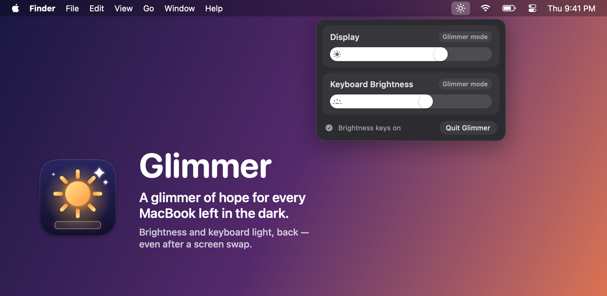
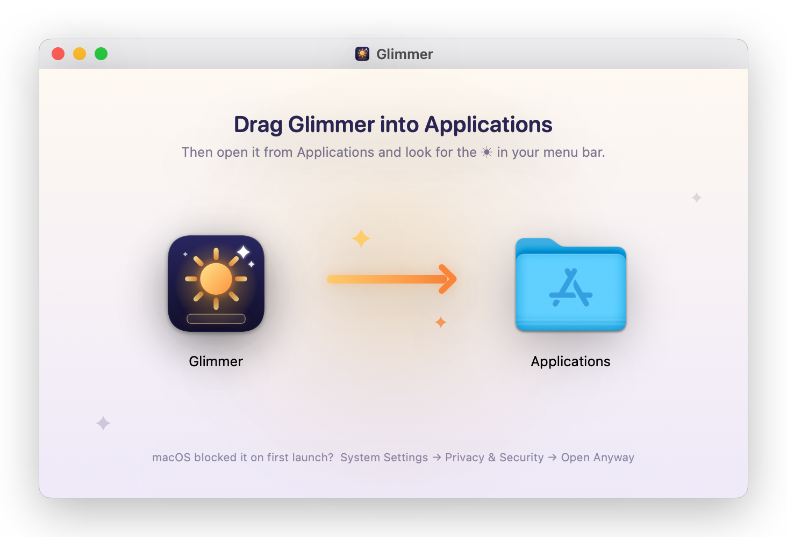
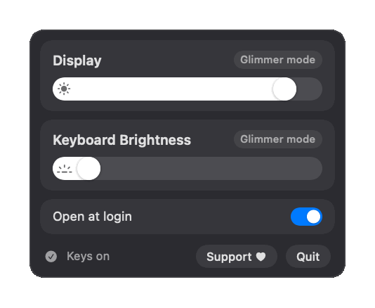
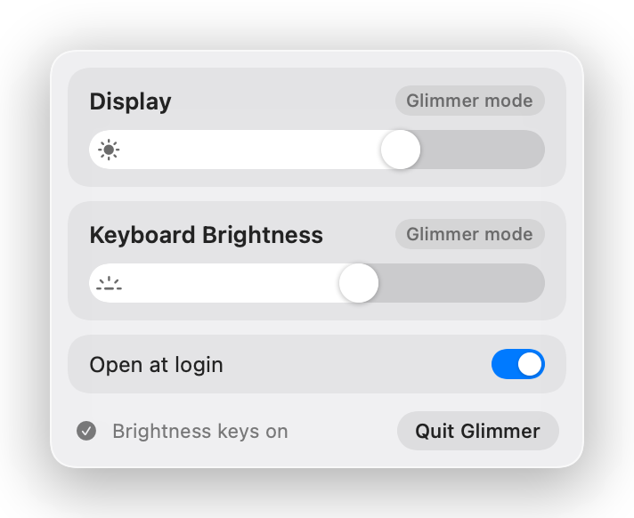

<p align="center">
  
</p>

<h1 align="center">Glimmer</h1>

<p align="center">
  <b>A glimmer of hope for every MacBook left in the dark.</b><br>
  Screen brightness and keyboard light, back — even after a screen swap.
</p>

<p align="center">
  <a href="https://github.com/adfleshner/mac-glimmer/releases/latest/download/Glimmer.dmg">
    
  </a><br>
  <sub>Free · Apple Silicon & Intel · macOS 13 Ventura or later · <a href="https://github.com/adfleshner/mac-glimmer/releases/latest">Release notes</a></sub>
</p>

<p align="center">
  
</p>

## TL;DR

**Swapped your MacBook's screen and now the keyboard light dies at login and the brightness
keys do nothing?** It isn't broken hardware. macOS doesn't recognise the new panel, so it
gives up on brightness. Glimmer is a tiny menu bar app that takes over where macOS gave up.

**Install in a minute:**

1. **[Download Glimmer.dmg](https://github.com/adfleshner/mac-glimmer/releases/latest/download/Glimmer.dmg)**, open it and drag **Glimmer** onto **Applications**.
2. Open Glimmer from Applications. If macOS says it *can't be opened*, go to
   **System Settings → Privacy & Security** and click **Open Anyway** (once — Glimmer isn't notarized by Apple).
3. Click the **☀︎** in the menu bar. If it shows **Enable brightness keys…**, click it and switch
   Glimmer on in **System Settings → Privacy & Security → Accessibility**.

<p align="center">
  
</p>

That's it. Glimmer opens at every login (switch it off with **Open at login** in its panel).
To remove it, quit it from the panel and drag it to the Trash.

Prefer to build it yourself? `git clone https://github.com/adfleshner/mac-glimmer.git && cd mac-glimmer && ./scripts/install.sh`

---

Glimmer is a tiny menu bar app for macOS that brings back working screen-brightness and
keyboard-backlight controls on MacBooks where macOS has lost them. When macOS's own controls
work, Glimmer simply uses them. When they don't — typically after a display from a different
model or year has been fitted — Glimmer steps in with its own workarounds, so the brightness
keys, the Touch Bar buttons and a Control Center–style slider panel all work again.

No new Mac. No logic-board repair. No turning off System Integrity Protection.

<p align="center">
  
  &nbsp;
  
</p>

---

## The problem it fixes

You replace your MacBook Pro's screen — with a used or refurbished panel, a donor screen from
another year, or the screen from your old Mac. The picture is perfect. But:

- 🔅 **The keyboard backlight is on at the login screen, then switches off the moment you log in** — and never comes back.
- 🔅 **Screen brightness keys do nothing** (or show the brightness indicator with no effect).
- 🔅 The **Touch Bar brightness slider** and the **Control Center keyboard brightness** slider don't work.
- 🔅 Clearing caches, Safe Mode, SMC and NVRAM resets, new user accounts and reinstalling macOS **don't help**.

It looks like a hardware fault, so people often give up and replace the whole Mac.

## Why it happens

It's a software mismatch, not broken hardware:

1. macOS's backlight driver identifies the built-in panel and looks it up in a table of panels
   that it expects for *that* Mac model. A screen from another model or year isn't on the list.
2. The driver comes up without a brightness level, so macOS's brightness service
   (`corebrightnessd`) fails to set up the built-in display ("can't change brightness").
3. The keyboard backlight is managed by the same service and tied to the display, so **as soon
   as a user session starts, the service drives the keyboard light to 0** and ignores the keys.
   Before login (at the login window) nothing has taken over yet — which is why the keys are lit there.

The full investigation, with the log lines and driver details, is in
[docs/how-it-works.md](docs/how-it-works.md).

## Why Glimmer was created

Glimmer was built for a 2019 15-inch MacBook Pro whose original screen failed and was
replaced with a perfectly good 2017 screen. For years the keyboard light and brightness
controls were dead, and every guide online said "reset the SMC" or "it's hardware". Instead of
buying a new Mac, the problem was traced step by step through macOS's logs and drivers down to
the panel-ID mismatch above — and Glimmer is the result: a small, safe, reversible fix that
anyone with the same problem can install in a minute.

## Features

- **Smart: native first, workaround only when needed.** At launch (and after every wake)
  Glimmer checks whether macOS can control the screen and the keyboard light. Anything that
  works natively stays native — Glimmer just gives you a nicer slider for it.
- **Keyboard backlight workaround.** Drives the keyboard's backlight device directly, reads the
  keyboard's own brightness range from the hardware, and immediately undoes macOS switching it
  off at login, after sleep and on idle.
- **Screen brightness workaround.** Smooth dimming that deepens shadows instead of a grey veil.
- **Brightness keys & Touch Bar buttons work again** — only the keys for the parts that need a
  workaround are taken over; everything else goes to macOS as usual.
- **Control Center–style panel** with Display and Keyboard Brightness capsule sliders, and a
  "Glimmer mode" badge showing which parts are running on a workaround.
- **Safe by design.** The screen never goes fully black: the lowest level stays readable, one
  more press of brightness-down turns the screen off, and *any* key or touch wakes it. Glimmer
  always starts at 50 % or brighter, and quitting it restores the screen instantly.
- **Nothing system-level is changed.** No kernel extensions, no SIP changes, no edits to
  system files. Uninstalling leaves your Mac exactly as it was.
- **Universal** (Apple Silicon + Intel), macOS 13 Ventura or later.

## Install

### Download (recommended)

1. Download **[Glimmer.dmg](https://github.com/adfleshner/mac-glimmer/releases/latest/download/Glimmer.dmg)** (always the latest release).
2. Open it and drag **Glimmer** onto **Applications**, then open Glimmer from Applications.
   (Running it straight from the disk image just reminds you to move it first.)
3. First launch only: if macOS says Glimmer *can't be opened* or *can't be verified*, open
   **System Settings → Privacy & Security** and click **Open Anyway**. Glimmer is free and open
   source but isn't notarized by Apple, so macOS asks once.

Glimmer adds itself to **Login Items** the first time it runs; switch that off any time with
**Open at login** in its panel (or in System Settings → General → Login Items).

If your Mac needs the brightness-key workaround, the panel shows **Enable brightness keys…** —
click it and switch Glimmer on in **System Settings → Privacy & Security → Accessibility**.

### Build from source

Requires the Xcode Command Line Tools (`xcode-select --install`).

```bash
git clone https://github.com/adfleshner/mac-glimmer.git
cd mac-glimmer
./scripts/install.sh      # builds, copies to ~/Applications and opens it
./scripts/make-dmg.sh     # or: build the drag-to-install disk image into ./dist
```

Every push is built by GitHub Actions, and pushing a version tag (`v1.2.0`) publishes a Release
with the DMG attached. See [docs/releasing.md](docs/releasing.md).

> **Tip:** to keep that permission across rebuilds, build with a real signing identity
> (`SIGN_IDENTITY=… ./scripts/build.sh`; the build script picks up an "Apple Development"
> certificate automatically). Ad-hoc–signed rebuilds need the permission granted again.

### Uninstall

Quit Glimmer from its panel and drag it to the Trash — or, from the source folder:

```bash
./scripts/uninstall.sh   # also removes the login item, settings and permission
```

### Icon and screenshots

The app icon and every image in this README are drawn by Glimmer itself from its real SwiftUI
views. After changing the panel or the icon, regenerate them with `./scripts/render-assets.sh`.

## How each part decides what to use

| | Native (macOS works) | Glimmer workaround (macOS can't) |
|---|---|---|
| **Screen** | Real backlight via DisplayServices | Gamma dimming of the built-in display, never fully black, display sleep below the lowest level |
| **Keyboard light** | macOS brightness service | Direct control of the keyboard backlight device, re-applied whenever macOS forces it off |
| **Brightness keys** | Left to macOS | Routed to Glimmer (Accessibility permission) |

## Limitations

- In workaround mode the screen can only be made **darker** than the panel's fixed backlight
  level, and because the backlight itself stays on, black areas keep a slight glow. A
  backlight-level fix would need the driver to recognise the panel, which means modifying
  sealed system files — Glimmer deliberately doesn't do that.
- Apple's own **Touch Bar brightness slider** and **Control Center keyboard slider** talk
  straight to the broken service and can't be redirected; use the Touch Bar up/down buttons,
  the function keys, or Glimmer's panel instead.
- Tested on a MacBook Pro 15-inch 2019 (MacBookPro15,3) with a 2017 panel on macOS Sequoia.
  The keyboard workaround targets Intel MacBooks with backlit keyboards (2016–2020); on Macs
  where macOS works normally, Glimmer stays in native mode.

## FAQ

**Is my screen or keyboard broken?** Probably not. If the keyboard light is on at the login
window and goes off when you log in, the hardware works — macOS just isn't driving it.

**Will a macOS update break it?** Glimmer doesn't modify macOS, so updates install normally.
If a future macOS learns your panel, Glimmer will detect that and switch to native mode by itself.

**Does it use private APIs?** Yes — it reads and sets brightness through macOS's private
DisplayServices / CoreBrightness frameworks and the keyboard's HID interface, the same way
macOS itself does. That's why it isn't on the App Store.

**Is it safe?** It only changes the screen's colour table (reset when Glimmer quits) and the
keyboard light level. It can't stop your screen from waking, and it asks for nothing beyond
Accessibility (to see the brightness keys).

---

MIT licensed. Glimmer is an independent project and is not affiliated with or endorsed by Apple Inc.
MacBook, MacBook Pro, Touch Bar and macOS are trademarks of Apple Inc.
